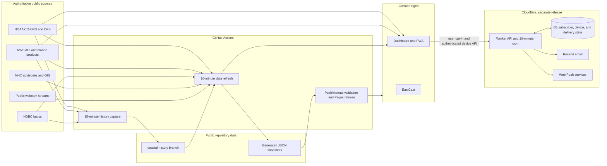

# SacoCast architecture

`nycguy/saco-coast-watch` on `main` is the only maintained source of truth. The public site is a static GitHub Pages application, with public data snapshots produced by Python collectors. Cloudflare Worker and D1 provide opt-in email and Web Push delivery; they are a separate, manually gated release.

## System map

## Component inventory

| Area | Implementation | Responsibility |
| --- | --- | --- |
| Dashboard shell | `index.html`, `css/`, `js/` | Accessible, framework-free interface; NOAA/NWS browser requests; charts, maps, weather, hazards, briefing, cameras, and PWA controls. `js/abellona-player.mjs` initializes the muted inline YouTube player near viewport, confirms actual `PLAYING` state, and covers unconfirmed poster imagery with a Watch Live fallback. |
| Weather and hazard logic | `js/weather.js`, `js/header-weather.js`, `js/hazards.js`, `js/intelligence.js` | Separates observations, forecasts, official alerts, and SacoCast-derived event ratings |
| Public snapshot collectors | `scripts/fetch_*.py` | Wind, NWS/NHC hazard guidance, fixed-window briefing, EastCast, and webcam metadata |
| Durable history | `scripts/capture_history.py`, `scripts/history_core.py`, `coastal-history` branch | Captured observations and forecast snapshots, event transitions, fixed 24/72-hour comparisons, and rolling camera frames |
| Regional view | `eastcast/` and `scripts/fetch_eastcast.py` | Public NOAA/NWS regional dashboard and snapshot |
| Notification interface | `js/push-ui.mjs`, `js/push-subscriptions.mjs`, `push-sw.js` | Explicit opt-in, per-device credentials, independent app/email preferences, threshold settings, device-owned delivery history, and browser delivery |
| Notification service | `alerts/src/worker.mjs`, `alerts/src/*.mjs`, `alerts/migrations/` | Existing email enrollment plus separately gated event and threshold push APIs, authenticated device history, D1 state, retries, and deduplication |
| Release workflows | `.github/workflows/` | Public data refresh, independent history capture, Pages publication, and manually gated Worker release |

## Data provenance and display rules

| Display | Source of truth | Meaning and limits |
| --- | --- | --- |
| Portland observed water | NOAA CO-OPS station 8418150, MLLW | A regional Portland gauge observation; never a Saco property flood measurement |
| Astronomical tide | NOAA CO-OPS predictions, MLLW | Tide-only prediction; it excludes storm surge and wave runup |
| Total-water model | NOAA OFS/GoMOFS guidance | Forecast guidance, shown as modeled rather than observed water |
| Water thresholds | Portland reference thresholds: Minor 12.0, Moderate 13.0, Major 14.0 ft MLLW | Preserved in dashboard, history schemas, and tests |
| Weather | NWS observations from KPWM/KSFM and hourly coastal-point forecast | Measurement time, station, forecast period, and units remain distinct |
| Offshore marine conditions | NDBC 44007 and WEXM1 when reported | Missing values stay unavailable; conversions are covered by deterministic tests |
| Official alerts | NWS active alerts and marine products | Official products and areas; not an inundation map or local application severity rating |
| Tropical guidance | NHC current storms, advisories, and GIS tracks/cones | Official storm identity and track guidance when supplied by NHC; no inferred classification |
| Derived event rating | SacoCast hazard and impact logic | An application classification from available official inputs, not an official warning |
| Historical briefing | Captured snapshots nearest fixed rolling windows | Uses consistent 24/72-hour periods, never the visitor's previous visit; unavailable history is not reconstructed |
| Weather header graphics | Current NWS hourly forecast, fresh measured wind, and official NWS alert labels | Forecast condition, observed wind, and event alert have separate accessible source labels |

Collectors retain source timestamps and provenance, reject malformed or stale inputs where required, and record unavailable source status rather than inventing a value. UI loading and outage states do not convert missing data to zero or an all-clear. Weather header observations older than two hours are not presented as current; wind below 8 mph does not produce a wind graphic. Reduced-motion preferences disable header animation.

The browser briefing payload contains current and derived summary fields only. Durable historical snapshots are served from `data/coastal-history.json`; raw history arrays are not duplicated into `data/coastal-briefing.json`. The Pages artifact validator enforces this separation and a 1 MB briefing payload ceiling for mobile users. The integrated briefing checks five coastal-impact inputs: NOAA OFS water guidance, NOAA tide predictions, NWS surf guidance, NWS hourly wind, and NDBC 44007 wave observations. It separately checks the Portland gauge observation, which uses a 45-minute freshness limit matching the live dashboard. Each input reports available, missing, stale, malformed, unavailable, unsupported, or not checked status with a plain-language reason. NDBC wave readings use a one-hour freshness window; NWS surf guidance older than 24 hours does not drive current coastal-impact scoring or hazard modes; the NWS hourly forecast snapshot uses a six-hour source-age limit. A source not requested by the standalone hazard feed is not reported as an outage. Coverage is not a forecast probability or skill score. A missing wave field in the latest buoy row does not erase a valid recent wave sample, but no prior 24-hour maximum is presented as a current measurement. Incomplete coverage is explicitly described as incomplete rather than an all-clear. The briefing's ranked watch list places threshold crossings and consequential forecast changes ahead of routine tides, and elevated high-water windows ahead of smaller forecast movements. A compatible 24-hour change under 0.15 ft is reported as essentially unchanged unless it crosses a flood threshold. Marine change sentences require fresh, same-station observations in both fixed-window captures; offshore buoy waves are identified as offshore measurements and never relabeled as local surf. Tide-only predictions stay labeled as tide-only.

History capture records local-news and public-community feed health separately from an empty result. It publishes only source status, matching-item count, checked time, and safe generic failure categories; response bodies and exception messages are not published. Facebook is explicitly not checked because reliable comprehensive public indexing is unavailable. Webcam preview errors leave the official live-camera link available, while archive UI distinguishes an empty rolling archive from a failed archive request.

## History and freshness

- The public snapshot workflow runs on a 10-minute schedule, subject to GitHub scheduling delay. The page polls published data on its normal browser cadence; direct NOAA/NWS requests remain independent of publication.
- The `coastal-history` branch is captured on a 15-minute schedule. It stores fixed-window inputs and event history; no visitor-session state is used as a baseline.
- Event camera capture is conditional on event focus and its rolling 24-hour retention rules. The Abellona Inn feed is live-only because no reliable public still-image archive source is used.
- Workflow data validation and deploy-artifact checks run on every refresh. Full unit, syntax, Worker, EastCast, browser, and live Pages smoke checks run on application pushes and manual refreshes.
- Schedules can be delayed or skipped. GitHub concurrency serializes Pages publication; a later successful refresh republishes current snapshots. The UI reports feed failures and retains official source links.

## Notification data and security

Email subscribers and push devices are separate identities. The browser stores only the device identifier and its random owner token; D1 stores the token hash. Authenticated device APIs require the matching bearer credential and configured Pages origin. The client does not search across devices or discover accounts by email. The Create/Manage button reports a push device as enrolled only after the Worker verifies that credential; email alert options remain available beside App settings, and email-only management uses a verified-address link. Returning to an open dashboard after email confirmation refreshes linked threshold settings. Updates made through email management or unsubscribe synchronize to explicitly linked devices while preserving each device's App-delivery preference. Notification history reads only that device's sent/failed event rows from the existing 30-day queue. It also exposes the latest successful custom-threshold send per metric and channel from existing `alert_state.last_sent`; email rows are returned only if that device is explicitly linked to the confirmed subscriber. The response omits email, subscriber ID, push endpoint, token, and provider errors. Failed threshold attempts are not retained, and the per-metric timestamps are not a complete attempt log. No schema migration or delivery-path change was needed.

Migrations 0002–0005 are additive. Production release uses the manually dispatched workflow in default read-only preflight mode; applying migrations and deploying requires the explicit workflow input. The workflow checks schema shape and aggregate subscriber-count preservation, never reads or prints secret values, never rotates an existing VAPID key, and never sends synthetic notifications. See [deployment](DEPLOYMENT.md) for the full release gate.

The comprehensive requirements and their verified status are tracked in [the product improvement matrix](PRODUCT-IMPROVEMENT-MATRIX.md).

## Cost and dependency guardrails

The architecture uses public NOAA, NWS, NDBC, and NHC data, standard GitHub-hosted Ubuntu runners for this public repository, GitHub Pages, and the existing Cloudflare/Resend notification setup. No paid runner, paid data API, private-source mirror, or additional hosting service is part of the application. Routine scheduled refreshes skip the full test suites but still validate fetched/generated data and the assembled Pages artifact. Cost estimates and the cadence tradeoff are in [the architecture review](ARCHITECTURE-REVIEW.md).
